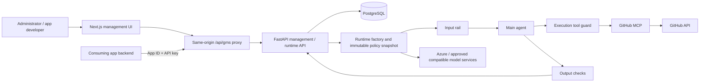
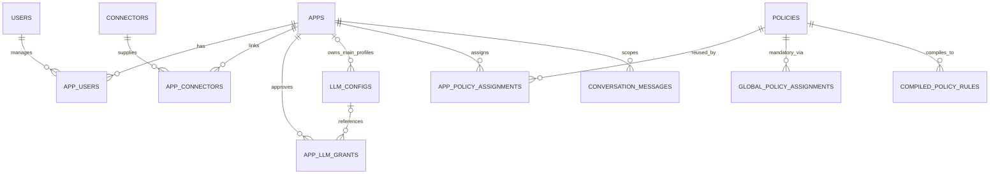
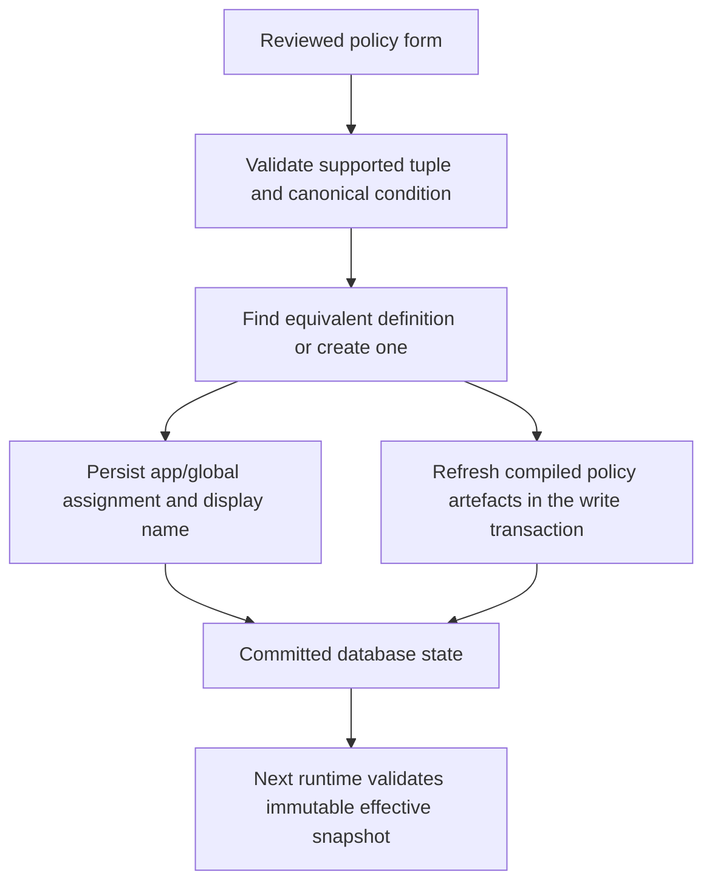

# Guardrails Management System — Developer Guide

Maintained by: GMS project maintainers  
Last reviewed: 23 October 2026  
Companion document: [User Guide](UserGuide.md)

This document adopts the section structure of the [SE-EDU AddressBook Level 4 Developer Guide](https://se-education.org/addressbook-level4/DeveloperGuide.html). All implementation descriptions and examples below concern GMS. Source files are authoritative; older dated review documents may describe superseded checkpoints.

The current source is implemented and has accepted local/hosted verification. The fresh online database, real supervisor account and second Azure deployment have **not** been provisioned by this documentation session. Use the [current release record](final-workday-handoff-2026-10-23.md) for deployment identities and remaining work.

## Contents

- [1. Setting up](#1-setting-up)
  - [1.1. Prerequisites and repository](#11-prerequisites-and-repository)
  - [1.2. Local dependencies and configuration](#12-local-dependencies-and-configuration)
  - [1.3. Initialising a fresh database](#13-initialising-a-fresh-database)
  - [1.4. Running the application](#14-running-the-application)
- [2. Design](#2-design)
  - [2.1. Architecture](#21-architecture)
  - [2.2. UI component](#22-ui-component)
  - [2.3. Logic component](#23-logic-component)
  - [2.4. Model component](#24-model-component)
  - [2.5. Storage component](#25-storage-component)
  - [2.6. Common components](#26-common-components)
- [3. Implementation](#3-implementation)
  - [3.1. Identity and permissions](#31-identity-and-permissions)
  - [3.2. Policy creation, compilation and assignment](#32-policy-creation-compilation-and-assignment)
  - [3.3. Resource and branch conditions](#33-resource-and-branch-conditions)
  - [3.4. Guarded execution, history and caches](#34-guarded-execution-history-and-caches)
  - [3.5. Model registration and integration](#35-model-registration-and-integration)
  - [3.6. Logging and timing](#36-logging-and-timing)
  - [3.7. Configuration](#37-configuration)
- [4. Documentation](#4-documentation)
- [5. Testing](#5-testing)
- [6. Dev Ops](#6-dev-ops)
- [Appendix A: Product Scope](#appendix-a-product-scope)
- [Appendix B: User Stories](#appendix-b-user-stories)
- [Appendix C: Use Cases](#appendix-c-use-cases)
- [Appendix D: Non Functional Requirements](#appendix-d-non-functional-requirements)
- [Appendix E: Glossary](#appendix-e-glossary)
- [Appendix F: Product Survey](#appendix-f-product-survey)
- [Appendix G: Instructions for Manual Testing](#appendix-g-instructions-for-manual-testing)

## 1. Setting up

### 1.1. Prerequisites and repository

Use the repository `adibice1/nemo-mcp-guardrails-test` and read [AGENTS.md](../AGENTS.md) before edits. The project has no Python package-install manifest such as `pyproject.toml`; development scripts add `src` to the import path using `scripts/_bootstrap.py`.

| Dependency | Project baseline | Purpose |
| --- | --- | --- |
| Python | 3.12, matching the backend image | API, policy compiler and diagnostics |
| Node.js | 24, matching image/CI; package engines permit 22–24 | Frontend development/build |
| npm | Use a compatible npm with the committed lockfile | Reproducible frontend installation |
| PostgreSQL | 16 in local/disposable containers | Persistent relational data |
| Docker with Linux containers | Linux AMD64 for release images | PostgreSQL, images and local MCP launcher |
| Git | Existing team workflow | Source/version control |
| Model service and GitHub credential | Provisioned separately | Opt-in live execution only |

The source pins Next.js 16.4.2, React 19.3.1 and NeMo Guardrails 0.21.0. Use `frontend/package-lock.json`, `requirements.txt` and `constraints.txt`; do not follow historical Next.js 13 setup or install unrelated latest vendor SDKs to make a recipe work. Model-provider installation is separate from serving a model.

Clone/open the repository and work from its root. Choose the supervisor's agreed release/development branch; no new branch strategy is imposed by this guide. Record the exact commit when building a release.

### 1.2. Local dependencies and configuration

PowerShell example for a new local checkout:

```powershell
py -3.12 -m venv .venv
.\.venv\Scripts\Activate.ps1
python -m pip install -r requirements.txt
python -m pip check
npm.cmd --prefix frontend ci
```

`requirements.txt` includes `-c constraints.txt`, so both files are required. If `.venv` already exists, inspect/reuse its intended Python environment instead of blindly recreating it. Linux equivalents are `python3.12 -m venv .venv`, `source .venv/bin/activate` and `npm` in place of `npm.cmd`.

Create a private root `.env` from `.env.example` only if no local `.env` exists. The example currently contains repeated JWT settings and development placeholders: reconcile it to **one reviewed definition per setting**. Do not overwrite a working private configuration. Supply real values privately; no guide needs them.

For a home PostgreSQL container, set `POSTGRES_PORT=5433` before starting it because the Windows host may already use 5432:

```powershell
docker compose up -d postgres
docker compose ps postgres
```

The SQLAlchemy `DATABASE_URL` for source runs must target the intended host database and host port, normally `127.0.0.1:5433` at home. Inside Docker, `localhost` means that container; Compose uses `postgres:5432`. A persistent volume retains its initial PostgreSQL credentials, even if you later edit `.env`. Do not delete the volume to resolve an authentication error.

Review [configuration](#37-configuration) before startup. Offline checks need no real credentials; live execution requires models, both model-role grants, the connector link/credential and database policies.

### 1.3. Initialising a fresh database

This section applies only to a deliberately **new empty database**. The current release decision is fresh data on the existing Azure environment, preserving the old database for rollback. The PostgreSQL database itself must be created by an authorised operator; application startup does not create it.

1. Confirm the server and exact new database name with the operator. Verify the target has no existing application tables/data. Use a database identity query rather than relying solely on a healthy API.
2. Configure the private `DATABASE_URL` for that target. Set `PYTHONPATH` for an operator console if needed:

   ```powershell
   $env:PYTHONPATH = Join-Path (Get-Location).Path "src"
   ```

3. Initialise current tables through `create_database_tables()` in `database/connection.py`, or allow API startup to call it on the verified blank database. It delegates to SQLAlchemy `Base.metadata.create_all`. This creates missing tables; it does **not** upgrade incompatible existing tables.
4. From the checked-out source and its configured venv, run:

   ```powershell
   python -B scripts/seed_normalized_policy_metadata.py
   ```

   This seeds the connector/action/resource/tool catalogue, including GitHub metadata. It is not first-admin provisioning. The normal backend runtime image excludes `scripts/`, so run this from a controlled source/operator environment with target connectivity.
5. Bootstrap the first admin through a controlled operator/database procedure using the existing model and password hasher. The required fields are below. There is no public bootstrap endpoint; `/management-users` requires an existing admin and public signup is disabled. Perform this as a single controlled transaction, checking the exact target database and absence of users before insertion. Stop if users already exist; do not reset an existing administrator through this fresh-install procedure.

   | `UserRecord` field | Initial value |
   | --- | --- |
   | `email` | Intended administrator's normalised email |
   | `username`, `name` | Agreed unique username and display name |
   | `system_role`, `enabled` | `admin`, `True` |
   | `password_hash` | `management_auth.hash_password()` of a privately generated temporary password |
   | `must_change_password` | `True` |
   | `temporary_password_expires_at` | Current timezone-aware UTC time + 24 hours |

   Generate a high-entropy temporary password using the existing `gms-` plus `secrets.token_urlsafe(24)` convention. Deliver it privately once; do not pass it in a shell argument, include it in Git or capture it in an execution report. For this handover the intended email/username is `admin@gmail.com`; no actual account/password has been provisioned here.
6. Have the administrator log in, replace the password and log in again. Verify setup credentials cannot access `/apps`, and that the old setup token is invalid after replacement. Normal subsequent users are created through User Management.
7. Establish the mandatory global credential-output policy through authenticated normal policy/assignment APIs or the UI. For operator/API use, the following policy body is accepted by the current schema:

   ```json
   {
     "policy_type": "output",
     "category": "credentials",
     "effect": "block",
     "enabled": true,
     "conditions": {
       "output_rule": "Do not reveal API keys, access tokens, passwords, environment variables or other secrets."
     }
   }
   ```

   Submit to `POST /policies` as an admin, then use its returned ID in `POST /global-policy-assignments` with `{"policy_ids": [POLICY_ID], "enabled": true}`. Substitute the actual integer; never rely on an old installation's numeric IDs. The UI's global output-policy workflow provides the equivalent assignment behaviour.
8. Create only the intended new apps/users. Explicitly approve each app's main/classifier choices, provision the connector and assign intended app policies before runtime acceptance.

The blank-schema/catalogue/admin-setup/global-policy flow has passed a disposable PostgreSQL rehearsal. Actual fresh online provisioning remains a release operation. Preserve home/work model-encryption keys with their existing data; privately provision an independent key for a genuinely new dataset if required.

For an **existing** database, inventory its schema/data first, back it up and review only the required migration differences on a restored rehearsal copy. Do not run every historical migration or bypass helpers that restrict writes to explicitly named rehearsal databases. See [the production worksheet](production-readiness-worksheet-2026-10-23.md).

### 1.4. Running the application

Start the API in the configured Python environment:

```powershell
python -B scripts/run_api.py
```

It listens on `127.0.0.1:8000` with reload disabled and proxy headers disabled. Restart it after source/environment changes. In another terminal:

```powershell
$env:NEXT_PUBLIC_API_BASE_URL = "/api/gms"
$env:GMS_API_BASE_URL = "http://127.0.0.1:8000"
npm.cmd --prefix frontend run dev
```

Open `http://localhost:3000/login`. The selected same-origin proxy path avoids placing backend secrets in browser configuration. If `frontend/.env.local` is used, keep these settings consistent with it. An absent frontend API base can activate mock/preview behaviour; verify real proxy health before accepting a workflow.

```powershell
Invoke-RestMethod http://127.0.0.1:8000/health
Invoke-RestMethod http://127.0.0.1:8000/health/db
Invoke-RestMethod http://localhost:3000/api/gms/health
```

Source-mode GitHub MCP defaults to its pinned Docker launcher. Backend images use the bundled native executable. Docker must be available for the source launcher; no Docker-in-Docker is required for the backend image. Keep `GITHUB_MCP_READ_ONLY=1` for normal checks. Stop local foreground servers with Ctrl+C; do not remove database volumes as part of ordinary shutdown.

## 2. Design

### 2.1. Architecture

GMS is a full proxy with distinct management and runtime authentication boundaries. It owns agent/tool execution; it is not just a pre-check service that returns an allow flag to an uncontrolled external agent.



Figure 1. Component responsibilities. Block/error paths can end execution before later components run. The proxy can also serve consuming-app API traffic; the app key belongs in that consuming app's backend.

On the agreed ACI target, frontend public port 80 and backend private port 8000 share the container group's network namespace. The frontend proxies to `http://127.0.0.1:8000`. Verify the actual existing deployment layout before applying that target contract to a replacement deployment.

```mermaid
sequenceDiagram
    participant C as Client backend
    participant A as FastAPI
    participant D as PostgreSQL
    participant R as Runtime / rails
    participant T as Guarded MCP tool
    C->>A: POST /v1/guardrails/run, app headers
    A->>D: Authenticate authorised app; load scoped history
    A->>R: Build validated app runtime
    R->>D: Read policies, grants, connectors; validate snapshot
    R->>R: Input classification
    alt Input allowed
        R->>R: Main agent chooses action
        opt Agent invokes a tool
            R->>T: Check immutable tool rules
            T-->>R: Allowed result, policy block or controlled error
        end
        R->>R: Output checks if execution can continue
    else Input blocked
        R->>R: Produce controlled refusal; skip agent/tools/output
    end
    R-->>A: Structured execution result
    A->>D: Store applicable conversation and execution evidence
    A-->>C: JSON result / controlled HTTP error
```

Figure 2. Request coordination. Output checks do not undo a completed remote tool operation. Detailed middleware logging uses a separate transaction and has failure-reporting behaviour described below.

### 2.2. UI component

The Next.js App Router frontend is under `frontend/`. It uses React components, shared styles and `frontend/lib/api-client.ts` for API calls. `frontend/lib/management-auth.ts` keeps the management session in session storage, or local storage when Remember Me is selected.

| Route/component | Responsibility |
| --- | --- |
| `app/login`, `app/setup-password`, `app/signup` | Login, forced password replacement, disabled-signup notice |
| `app/apps`, `app/apps/[clientId]` | App list and detail tabs |
| `components/apps/app-overview.tsx` | Name changes and one-time app key regeneration |
| `components/apps/app-connectors.tsx` | Connector provisioning and existing-link controls |
| `components/apps/app-models.tsx`, `create-llm-config-modal.tsx` | App model choices, unified registration, admin grants |
| `app/policies`, `components/policies/` | Assignment workflows, summary, branch conditions and AI drafting |
| `components/apps/app-runtime-test.tsx` | Real app-authenticated request and stage/result display |
| `app/logs`, `app/logs/[requestId]` | Admin runtime Traffic/Audit evidence |
| `app/user-management`, `app/settings` | Account administration and own settings |
| `app/api/gms/[...path]/route.ts` | Server-side same-origin API proxy |

Hidden/disabled controls improve usability; API permissions remain authoritative. The standalone `/policy-preview` is a sample/offline preview, not evidence that a live policy was saved or enforced.

### 2.3. Logic component

FastAPI routers under `src/nemo_mcp_guardrails/api/` validate requests and enforce dependencies. Domain modules provide the compiler, credentials, guarded execution and cache behaviour. Keep those responsibilities separate when extending a route.

| Module | Responsibility |
| --- | --- |
| `api/main.py` | Lifespan schema creation, routers and middleware |
| `management_auth.py`, `management_permissions.py`, `api/management_auth.py` | Password/JWT primitives, role/app access and management endpoints |
| `app_auth.py`, `api/auth.py` | Runtime app key hashing/verification and dependency |
| `policy_rule_service.py`, `policy_compiler.py` | Convert policy definitions into prompt/tool/test artefacts |
| `resource_conditions.py`, `github_resource_bindings.py`, `github_tool_contract.py` | Validated selectors and observable tool/argument contract |
| `database/runtime_policy_snapshot.py`, `runtime_factory.py` | Consistent policy state and app runtime construction/cache |
| `guarded_execution.py`, `tool_guard.py`, `output_guard.py` | Request-stage orchestration and execution/output enforcement |
| `api/policy_assistant.py`, `api/policy_assistant_branches.py` | Structured drafts and branch-intent validation |

Use [the file map](file-map.md) to locate additional modules. Do not bypass snapshot, grant or credential checks by constructing a second ad hoc runtime in a route.

### 2.4. Model component

SQLAlchemy ORM records are defined in `database/models.py`. Pydantic request/read schemas live beside API routers. The central concepts are:



Figure 3. Selected relationships; this is a conceptual subset, not complete DDL. Apps also reference their selected main/classifier configurations. A nullable grant config denotes the environment default, and global catalogue configurations have no owning app.

Other records cover connector actions/resources/tool mappings, expected-tool test metadata, runtime log headers/events/content and management audit metadata. Internal numeric `app_id` and externally supplied `client_id` are different identifiers. Client-ID alias routes resolve to the same rows and permission logic.

### 2.5. Storage component

`database/connection.py` creates a SQLAlchemy engine and session factory. `.env`/process configuration supplies the connection; use protected runtime injection in deployment. PostgreSQL holds users, apps, policies, assignments, grants, conversation history and logs.

- Management passwords use salted scrypt hashes.
- App API keys are generated server-side, returned once and stored as SHA-256 hashes with constant-time verification.
- App-owned model keys use authenticated Fernet encryption, bound to the owning app, provider, endpoint and model. Read schemas omit keys, ciphertext and credential references.
- Admin-managed LLM and connector references resolve approved backend environment variable names. Approval is checked before secret lookup.

The model-encryption key must be backed up separately from the database. Losing it prevents decryption; switching it without re-encryption is not key rotation. Restoring ciphertext requires its matching key. Secrets-manager provider integration remains deferred.

### 2.6. Common components

`request_limits.py` bounds raw bodies and runtime schema inputs. `rate_limits.py` provides the current in-process throttling contract. `performance.py`, `runtime_events.py`, `runtime_logging.py` and `management_audit.py` provide timing and evidence capture. Credential/endpoint modules centralise fail-closed resolution.

The middleware order makes the request-body cap outermost so an oversized body can be rejected before inner logging/JSON parsing. Do not add middleware that reads unlimited bodies or logs credential headers. Uvicorn ignores untrusted forwarded headers under the existing rate-limit design.

## 3. Implementation

### 3.1. Identity and permissions

There are two independent authentication paths:

| Caller | Authentication | Protected operations |
| --- | --- | --- |
| Management browser/tooling | `Authorization: Bearer MANAGEMENT_JWT` | Apps/policies/configuration, users and logs |
| Consuming application backend | `X-App-ID: CLIENT_ID`, `X-API-Key: APP_KEY` | `/v1/guardrails/auth-check` and `/v1/guardrails/run` |

Management JWTs require a signing secret of at least 32 characters. Tokens bind to the user's current password/setup state and are rechecked against the stored user. A reset/password change invalidates earlier tokens. Newly issued/reset passwords expire after 24 hours and receive a setup-only token; it can read own identity and replace the password, not perform normal management CRUD.

System admins can access all apps. Developers require the appropriate app link; current internal manageable link roles are `admin`/`owner`, while the user-facing workflow calls the assigned person a Developer. Do not confuse that app-link role with the user's `system_role`.

App creation, user administration, global changes, classifier selection and explicit model grant mutation are system-admin operations. Linked developers can manage their app's permitted metadata/policy assignments and existing connector toggles/unlinks. Provisioning connector links or explicitly changing credential references requires system admin. A developer update must omit `authorized` entirely—even an unchanged/null field is rejected.

`auth-check` proves app identity only. It does not validate grants, model services, policies or MCP availability. Runtime rejects missing/wrong keys, unknown clients and unauthorised apps with the same generic 401.

### 3.2. Policy creation, compilation and assignment

`policies` contains reusable definitions; assignment tables establish app/global scope. Preferred frontend mutations use duplicate-aware resolution:

| Method/path | Behaviour |
| --- | --- |
| `POST /apps/by-client-id/{client_id}/policy-assignments/resolve` | Resolve/create a definition and assign it to this app |
| `PUT /apps/by-client-id/{client_id}/policy-assignments/{assignment_id}/resolve` | Resolve edited behaviour for one assignment |
| `POST /global-policy-assignments/resolve` | Admin global equivalent |
| `PUT /global-policy-assignments/{assignment_id}/resolve` | Admin global assignment edit |

Resolution returns `created`, `reused` or `already_assigned`, definition/assignment IDs and the display label. Assignment-safe edits avoid mutating a shared definition behind another app. Frontend delete removes an assignment. Direct definition deletion is admin-only and returns 409 while still assigned.



Figure 4. Reuse and compilation responsibilities. Existing definitions can be reused without creating duplicates; new/updated definitions refresh compiled rows. Stale compiled rows are disabled.

Input policy compilation generates NeMo prompt rules, guarded write-tool restrictions and diagnostic blocked prompts. Output policies compile prompt restrictions and supported deterministic phrase checks. `config/prompts.yml` stays a stable template; `prompt_rule_compiler.py` injects database-derived rules.

`POST /policies/compile-preview` is an inspection operation. `POST /policies/compile-rules` is an admin manual resync; it is not needed after every ordinary UI save. An allowed test case is a test fixture, not an allow-rule that overrides policies.

### 3.3. Resource and branch conditions

`GET /policy-options` exposes enabled supported write-policy combinations and their conditional fields. The backend validates these even if a client bypasses the UI. Connector metadata containing a read tool does not imply read-block policy support.

Selectors use bounded canonical grammar, for example:

```text
title = "presentation-test"
number = 17
source_branch != "staging" AND target_branch = "production"
```

Single equality uses condition format/version 1. Supported PR source/target conjunctions or inequality use version 2. The integer `resource_condition_version` resides in `conditions` JSON; it does not by itself prove enforcement. Names/titles case-fold, paths/branches preserve case, and literal punctuation/Unicode are retained. Legacy unversioned conditions need explicit review; automatic reuse/deduplication does not promote them.

Tool enforcement uses immutable compiled rules and the reviewed GitHub tool/field/method contract. A matched rule raises a policy violation before forwarding the MCP invocation. Malformed/unobservable target state produces a controlled evaluation error without falsely attaching a matched policy.

PR creation uses actual head/base arguments. Branch-dependent merge checks use trusted PR metadata, not agent-provided branch claims, but the pinned connector cannot atomically pin the target branch when merging. Consequently selective merging is unavailable: nonmatching branch-restricted merges are also refused. Do not disable/recreate legacy policies or describe a branch allow-workflow as implemented.

### 3.4. Guarded execution, history and caches

`runtime_factory.py` resolves authorised app connector access, policy snapshot, live model-role grants and approved credentials before constructing usable runtime parts. Both named configurations and null/environment defaults require explicit enabled grants for the correct app/purpose.

Effective rules include enabled global plus app assignments. Database/policy failures stop setup; authenticated runtime does not silently fall back to diagnostic defaults. A legitimate empty policy scope remains empty.

Cache reuse validates exact policy/grant/configuration contents, including after construction and lock waits. Cache-disabled execution preserves security checks. Revocation/configuration changes prevent subsequent reuse; a request already admitted may finish on its snapshot. Environment/secret changes require an API restart or container recreation as appropriate.

`guarded_execution.py` owns input rail → agent/guarded tools → output sequence. `tool_guard.py` also observes actual wrapper invocations. A successful plain answer with no tool invocation reports Tool guard `not run`; historic `passed` badges without tool events must not be treated as invocation evidence.

Conversation history is scoped by app and conversation ID. Supplied history bootstraps only when there is no stored conversation; stored history takes precedence. The newest bounded usable tail is selected, then the context-character budget is applied. Reusing an ID intentionally retains context; use fresh IDs for independent tests. The execution timeout prevents subsequent conversation persistence on that timeout path, but remote operations may already have occurred.

#### Consuming-app integration example

Send requests from the consuming app's **backend**, which privately receives `GMS_BASE_URL`, `GMS_APP_CLIENT_ID` and `GMS_APP_API_KEY`. These example names are client configuration, not new GMS server settings. Use the deployed same-origin API root, for example `https://YOUR_GMS_HOST/api/gms`; the recorded HTTP deployment has a transport-security limitation.

```python
import json
import os
from urllib.error import HTTPError
from urllib.request import HTTPRedirectHandler, Request, build_opener
from uuid import uuid4

class NoRedirect(HTTPRedirectHandler):
    """Keep app credentials on the explicitly configured destination."""

    def redirect_request(self, req, fp, code, msg, headers, newurl):
        return None

opener = build_opener(NoRedirect())
base = os.environ["GMS_BASE_URL"].rstrip("/")
headers = {
    "Content-Type": "application/json",
    "X-App-ID": os.environ["GMS_APP_CLIENT_ID"],
    "X-API-Key": os.environ["GMS_APP_API_KEY"],
}
payload = {
    "message": "List branches in OWNER/REPOSITORY. Do not create or modify anything.",
    "conversation_id": "guide-" + uuid4().hex,
    "conversation_history": [],
}
request = Request(base + "/v1/guardrails/run",
                  data=json.dumps(payload).encode("utf-8"),
                  headers=headers, method="POST")
try:
    with opener.open(request, timeout=180) as response:
        result = json.load(response)
except HTTPError as error:
    # Log only approved metadata; never log request headers or keys.
    raise RuntimeError(f"GMS HTTP error: {error.code}") from None
print(result["status"], result["response"])
```

Replace the example repository with one available to the app's GitHub credential. This snippet is an integration shape, not a live request performed by this guide. Client timeout is distinct from backend setup/execution timeouts and does not guarantee remote cancellation.

A completed policy block can be HTTP 200; inspect `status`, `block_stage`, `block_reason` and rail/tool status fields. Successful results do not certify factual grounding. Controlled HTTP paths include 401 invalid app credentials, 403 connector access, 413 body cap, 422 schema errors, 503 unavailable runtime configuration/model evaluation and 504 execution timeout. Generic infrastructure errors remain possible; handle non-JSON errors and retries in the consuming app. Never automatically retry a possible remote write based only on a timeout.

### 3.5. Model registration and integration

The profile API supports Azure (`azure` legacy alias or `azure_openai`) and approved `openai_compatible` chat endpoints. Native vendor protocols need a separately provisioned compatible gateway or reviewed adapter. NeMo's engine catalogue and GMS's accepted profile protocols are different layers.

**App-owned main profiles:**

- `POST /apps/{app_id}/main-models` or its `by-client-id` alias accepts `name`, `provider`, `model_name`, `endpoint`, `api_key`.
- Linked developers/admins can register. The profile and enabled main grant are created atomically; app selection remains a separate update.
- An owned profile cannot be used cross-app or as a classifier, even if an inappropriate grant row exists.
- API read responses omit the key/ciphertext/reference. The dedicated `GMS_MODEL_CREDENTIAL_ENCRYPTION_KEY` is required for encryption/decryption.

Example request shape (values are synthetic; never commit real keys):

```json
{
  "name": "Research main model",
  "provider": "openai_compatible",
  "model_name": "YOUR_SERVED_MODEL_ID",
  "endpoint": "https://models.example.com/v1",
  "api_key": "REPLACE_PRIVATELY"
}
```

**Admin-managed profiles:** `POST /llm-configs` uses `credential_reference: "env:TEAM_MODEL_KEY"`, not `api_key`. The UI accepts only `TEAM_MODEL_KEY` and adds `env:` itself. Compatible profiles require the explicit approved base/reference; Azure can fall back to its configured defaults. Create profiles, approve their app/purpose grants, then save selections.

| Operation | Endpoint |
| --- | --- |
| List valid app choices | `GET /apps/{app_id}/llm-options?purpose=main` or `purpose=guardrail` |
| List grant metadata | `GET /apps/{app_id}/llm-grants` |
| Enable/disable explicit grant | `PUT /apps/{app_id}/llm-grants/{purpose}/{config_ref}` with `{"enabled": true}` or false |
| Revoke grant | `DELETE /apps/{app_id}/llm-grants/{purpose}/{config_ref}` |
| Save model selections | `PUT /apps/{app_id}` with approved `main_llm_config_id` and/or admin-only `guardrail_llm_config_id` |

`config_ref` is an actual profile ID or `default`. The client-ID aliases share access checks. Null selected IDs refer to environment defaults and still require grants. Read/create endpoints do not select a model implicitly. New apps receive no automatic default grants.

Model service acceptance has three independent roles:

1. Main: actual tool calling and faithful use of returned results.
2. Classifier: valid complete yes/no decisions across allowed, blocked, ambiguous and invalid-result cases; compatible classifier parsing fails closed.
3. Policy authoring, if configured: structured schema-valid drafts and correct intent/conditions; examples remain predictions.

Policy authoring uses separate backend settings. Its default is Azure; an independently configured compatible authoring profile is supported through `GMS_POLICY_AI_*`. It is not selected by changing an app's main/classifier dropdowns.

Use [the provider setup guide](supported-llm-setup-guide.md), [field/payload reference](llm-provider-guide.md) and [gateway design](model-gateway-integration.md). Backend destination approvals remain mandatory for both credential modes. Runtime clients refuse redirects. Compatible HTTP is allowed only for explicitly approved literal loopback hosts, such as `127.0.0.1`; remote plain HTTP/private-IP URLs and `host.docker.internal` HTTP are not approved model destinations.

### 3.6. Logging and timing

Runtime middleware generates request IDs and persists request metadata, UTC timing and ordered stage/tool events. An independently protected user-content record can hold the input/final response for an authenticated runtime request. Logs APIs are admin-only:

- `GET /runtime-logs` with app/outcome/limit/offset filters.
- `GET /runtime-logs/{request_id}` for metadata/events.
- `GET /runtime-logs/{request_id}/user-content` for available captured content.
- `GET /audit-logs` for sanitised management mutation metadata.

Audit capture omits bodies, keys, credentials and raw tool arguments/results. Runtime debug, when explicitly enabled, is limited to event/tool names; legacy raw debug response/rule fields remain null. Do not add secret values to errors or arbitrary model reasoning to diagnostic responses.

Traffic event start/return pairs show execution activity, not independent correctness of parameters or returned data. Distinguish `tool_error`, a policy match and provider filtering. `X-GMS-Request-ID` and `Server-Timing` help correlate HTTP observations with recorded stages. HTTP/proxy timings are not literal browser rendering benchmarks.

Runtime persistence failures are reported to backend logging as `audit.write_failed`; do not assume missing DB records mean no request happened or that every log write is infallible. Verify log storage during deployment acceptance.

Retention is an operator action, not an automatically scheduled service. The existing helper defaults to preview and caps each batch at 500 expired completed requests:

```powershell
python -B scripts/cleanup_runtime_logs.py --days 30
```

Review its actual target and preview before using `--apply` under the retention policy. A 30-day example is not a supervisor-approved retention requirement. Keep production dumps/content out of Git and ordinary support reports.

### 3.7. Configuration

Use `.env` only for controlled source/local setup; deploy secrets through the owner's protected runtime mechanism. Frontend `NEXT_PUBLIC_*` values are public build configuration and must never contain secrets.

| Setting | Purpose and constraint |
| --- | --- |
| `DATABASE_URL` | Intended PostgreSQL database; verify identity and network path |
| `POSTGRES_*` | Compose/local database initialisation and host port; source SQLAlchemy URL remains authoritative for API connection |
| `GMS_JWT_SECRET`, `GMS_JWT_EXPIRY_MINUTES` | JWT signing secret, positive normal-session lifetime; default lifetime 480 minutes |
| `GMS_MODEL_CREDENTIAL_ENCRYPTION_KEY` | Dedicated Fernet key for owned model credentials; privately provision/back up separately |
| `AZURE_OPENAI_API_KEY`, `AZURE_OPENAI_ENDPOINT`, `AZURE_OPENAI_API_VERSION`, `AZURE_OPENAI_DEPLOYMENT` | Default Azure roles and default authoring configuration |
| `GMS_ALLOWED_LLM_ENDPOINTS` | Extra exact HTTPS origins for Azure; configured default Azure origin is automatically approved |
| `GMS_ALLOWED_COMPATIBLE_LLM_ENDPOINTS` | Exact compatible API base URLs including path, such as `/v1` |
| `GMS_ALLOWED_LLM_CREDENTIAL_ENV_VARS` | Extra permitted model credential variable names; default Azure key name is approved |
| `GITHUB_PERSONAL_ACCESS_TOKEN`, `GMS_ALLOWED_GITHUB_CREDENTIAL_ENV_VARS` | Default GitHub PAT and extra permitted credential names |
| `GITHUB_MCP_READ_ONLY` | Keep `1` for ordinary verification |
| `GITHUB_MCP_LAUNCH_MODE` | Direct source defaults to `docker`; image uses `native` with the pinned bundled executable |
| `GMS_POLICY_AI_PROVIDER`, `GMS_POLICY_AI_ENDPOINT`, `GMS_POLICY_AI_MODEL`, `GMS_POLICY_AI_CREDENTIAL_REFERENCE` | Separate optional compatible policy-authoring profile; same destination/credential controls |
| `NEMO_RUNTIME_DEBUG` | Normally disabled; event/tool-name diagnostics only |
| `NEMO_MAX_RUNTIME_CONTEXT_CHARS` | Final history context budget, default 24,000 characters |
| `NEMO_RUNTIME_CACHE_TTL_SECONDS`, `NEMO_RUNTIME_CACHE_MAX_APPS` | Default 300 seconds/32 app runtimes; do not bypass snapshot checks |
| `NEMO_CORS_ORIGINS` | Reviewed origins for direct browser-to-API development |
| `NEXT_PUBLIC_API_BASE_URL` | Use `/api/gms` for the frontend's same-origin contract; build-time for release images |
| `GMS_API_BASE_URL` | Frontend server's upstream; shared ACI localhost `http://127.0.0.1:8000`, Compose `http://backend:8000` |

Merge approval entries without deleting existing approvals. Never treat an approval list as a place to store key values. Environment changes require process restart; `docker restart` does not replace a container's original environment—recreate it using the reviewed configuration. Do not log full container/Azure environment exports.

## 4. Documentation

The public-facing guides are this file and [UserGuide.md](UserGuide.md). They are Markdown with relative links, explicit contents and Mermaid diagrams rendered by compatible viewers. GitHub renders Mermaid; plain text viewers still show the diagram source. Numbered structure and appendices follow the supplied SE-EDU templates, while examples and descriptions are original GMS material.

| Reference | When to use it |
| --- | --- |
| [User Guide](UserGuide.md) | Supported browser tasks and troubleshooting for users |
| [Supported-model setup](supported-llm-setup-guide.md) | Provider-specific serving/configuration recipes and role acceptance |
| [LLM field/payload guide](llm-provider-guide.md) | Exact registration/reference conventions |
| [Target architecture](target-architecture.md) | Confirmed product boundaries and future direction |
| [File map](file-map.md), [runtime flow](runtime-flow-map.md) | Detailed navigation; validate older line references against source |
| [Testing notes](testing-notes.md), [post-presentation results](post-presentation-verification-2026-10-22.md) | Accepted evidence and historical test records |
| [Current backlog](open-work-backlog.md) | Unfinished work; date/status matters |
| [Final-workday handoff](final-workday-handoff-2026-10-23.md), [readiness worksheet](production-readiness-worksheet-2026-10-23.md) | Actual fresh-release scope, ownership, images and remaining online checks |
| [Containerisation](containerisation.md) | Image/network contracts; use current handoff for actual release status |

When changing behaviour, update the relevant guide and model/API examples in the same change. Verify control names, permissions, paths, JSON shapes and supported limitations against code. Keep historical result documents dated rather than silently rewriting old evidence. Mark a proposed feature as proposed; never present an unsatisfied manual acceptance item as passed.

Diagrams in this file are conceptual, not generated full schema/class inventories. No fabricated screenshots are used. Add screenshots only from a verified current UI, with secrets/tokens/private content excluded and a clear caption/date.

## 5. Testing

### 5.1. Automated checks without live credentials

Use the explicit catalogue; do not discover and run every `tests/test_*.py`, because some are opt-in database/model/MCP diagnostics.

```powershell
python -B scripts/run_security_checks.py --list
python -B scripts/run_security_checks.py
python -B scripts/run_security_checks.py --test test_app_main_models
```

The current runner contains **38 named diagnostic groups**, not 38 individual assertions. It strips inherited application credentials, disables dotenv and external sockets, and uses disposable stores/fakes. It covers authentication/control boundaries, policy selectors/snapshots, tool contract/enforcement, model registration/grants, cache revocation, status attribution, debug privacy, events/logs and timing. A synthetic pass does not establish live provider/network availability.

For frontend checks, run from the `frontend/` directory:

```powershell
npm.cmd run lint
npm.cmd exec -- tsc --noEmit
npm.cmd run build
```

Return to the repository root before running Python/Docker commands below. Use `npm ci` before checking a new/changed lockfile. Do not apply `npm audit fix --force` to bypass a compatibility review.

### 5.2. Disposable PostgreSQL verification

The explicit harness creates its own internal Docker network, temporary PostgreSQL and synthetic worker environment, then removes only the resources it created:

```powershell
docker build --platform linux/amd64 -t gms-verification:local .
python -B scripts/run_postgres_checks.py --run --backend-image gms-verification:local
```

It currently runs 16 PostgreSQL diagnostics plus migration/idempotency/constraint checks. It does not use an inherited production URL or `.env` credentials. Docker/pulling images can require network access; the created test database is disposable. Inspect cleanup results before considering the run complete.

Database-specific individual diagnostics may create temporary apps, users or assignments. Use their documented target/cleanup guarantees; the explicit harness is the preferred routine path. Historical helpers with rehearsal-name guards remain guarded.

### 5.3. Images, live models and deployed acceptance

| Layer | Evidence it provides | Evidence it does not provide |
| --- | --- | --- |
| Offline catalogue | Deterministic security/domain behaviour | Real PostgreSQL, provider or connector availability |
| Disposable PostgreSQL | Real schema/relationships/API DB behaviour | Actual production data/configuration |
| Clean image build | Reproducible installation and build contracts | Published/running release identity |
| Real model/MCP read | End-to-end capability for that configuration | Universal model accuracy or other providers |
| Actual deployed acceptance | Intended images/database/proxy/login/read/block/logs | Broader production SLOs or all future operations |

Accepted evidence includes clean Linux image checks, real native-MCP/proxy reads, model registration/use, policy behaviour and synthetic recovery. The latest commit-tagged image IDs match the accepted images. Do not rerun every completed matrix merely to change documentation.

Live tests are opt-in. `tests/test_nemo_mcp.py --app-id ID` is a scoped diagnostic, not HTTP app authentication; a no-app run can load every enabled policy. Keep its normal read-only contract. Use unique conversation IDs and inspect actual `tool.started`/`tool.returned` events and expected answers. Never include raw tool/provider secrets in test output.

The narrow actual-deployment acceptance and manual procedures are in [Appendix G](#appendix-g-instructions-for-manual-testing). Distinguish UI rendering/permission checks from API automation. Tests need additional coverage when changing an enforcement boundary, not when merely restating implementation in a trivial assertion.

## 6. Dev Ops

### 6.1. Verification workflow and dependency management

`.github/workflows/verification.yml` runs on push, pull request and manual dispatch with read-only repository permissions. Backend CI builds the pinned image, runs the explicit offline catalogue with read-only test/script mounts and runs disposable PostgreSQL verification. Frontend CI uses pinned Node 24 for locked installation, ESLint, TypeScript and production build. CI does not deploy Azure resources.

Backend installation runs `pip check` during image build and removes pip from the final runtime. Do not expect `python -m pip` inside the deployed image. The image runs as UID 10001; frontend runs as non-root `nextjs` and grants Node only the capability needed to bind port 80. Changes to dependencies require compatibility/audit/build review, not ad hoc runtime installation.

Known Pillow/FastEmbed runtime and development-only braces findings remain documented in [the dependency review](python-dependency-review-2026-10-22.md). The user explicitly permits release with the recorded findings. They are unresolved; accepted builds/CI do not establish that those advisories are fixed. Follow the backlog for compatible remediation.

### 6.2. Build and publication

Build both components from the same reviewed checkout. Replace the example tag with the actual recorded release identifier:

```powershell
docker build --platform linux/amd64 -t guardrail-be:RELEASE_TAG .
docker build --platform linux/amd64 --build-arg NEXT_PUBLIC_API_BASE_URL=/api/gms -t guardrail-fe:RELEASE_TAG .\frontend
```

The prepared pair is tagged `fa76f78ba62d` locally; exact source/image IDs are in the current handoff. Local image IDs and published registry digests are different evidence. The images are on the home computer; a work/Cloud Shell session must rebuild the same source or receive an agreed transfer first.

After an authorised Azure/registry login, publish the matching immutable pair to `guardrail.azurecr.io`. Record returned digests and verified Azure configuration. Registry name/username alone does not authenticate. Do not infer the currently running version from a mutable `latest` tag.

### 6.3. Deployment configuration and rollback

Preserve the frontend public 80/backend private 8000 contract and same-origin proxy. The normal backend image bundles the pinned official native GitHub MCP executable; do not mount a Docker socket or replace it with an unreviewed binary. ACI exposes process ports directly; do not assume Docker-style port remapping.

Use external persistent PostgreSQL. Before the second deployment:

1. Discover the actual subscription, resource group, container layout, current image/configuration and database identities through an authenticated operator session.
2. Preserve the old database and protected runtime configuration for rollback.
3. Provision/validate the fresh target and supervisor admin using Section 1.3.
4. Publish the matching pair and update the verified deployment with its private new-target settings.
5. Record actual deployed image/database identities and run Appendix G's narrow acceptance.
6. Verify the supervisor has the backup, matching keys, operational access and rollback instructions before the outgoing user's work access ends.

Current public ingress is HTTP at `guardrails-fe.southeastasia.azurecontainer.io`. This is a recorded transport-security limitation; no HTTPS/custom-domain deployment was completed. Do not call the release secure solely because stored keys are encrypted. TLS ingress planning belongs with the deployment owner.

Current throttling/caches assume a single backend process. Multiple workers/replicas require a reviewed shared limit design and distributed-state considerations. An image redeploy does not reverse data changes; rollback requires compatible old images/configuration and the preserved database or reviewed restoration plan.

### 6.4. Backup, recovery and handover

Database dumps, secret values, signing/encryption keys and credential exports stay outside Git/images. Keep key custody separate from database backup custody. For recovery, restore into a controlled environment, verify constraints/relationships/policy artefacts, check applicable owned-model decryption with its matching key and exercise login/read-only runtime before accepting the restore.

Synthetic backup/key-recovery tests are accepted; actual backup transfer, contents/integrity, target recovery access and operational rollback still require evidence. A key-format check is not a decryption test. If a target has no owned profiles, state that scope instead of claiming stored-profile recovery.

The home direct TCP 5432 probe times out before database authentication, while the deployed backend's database health succeeds. These observations do not establish the root cause or identify the configured database. Work-side networking/resource discovery is still required. Do not change passwords, disable TLS or broaden firewall rules based only on a home timeout.

## Appendix A: Product Scope

**Target users:** system administrators who manage shared safeguards and linked developers who configure client apps. Maintainers/operators support deployment, credentials and recovery.

**Value:** manage reusable global/app-specific policies through an authenticated UI/API while GMS owns the complete input/agent/tool/output path. Keep main-agent capability separate from policy-classification configuration and make execution decisions inspectable.

**Implemented scope:** GitHub MCP runtime, management RBAC, app authentication, reusable policy assignments and automatic compilation, supported field/branch restrictions, Azure/compatible profiles, encrypted app-owned main models, conversation history and admin logs.

**Boundaries/future scope:** SharePoint/Outlook runtime, universal native-provider adapters, specialist NeMo rail integrations, selective branch merging, automatic model-key rotation, chosen production secrets-manager integration, shared multi-process limiting and automated CD. These are not promised by existing metadata or UI samples. See the backlog before proposing implementation.

## Appendix B: User Stories

Priority expresses product importance, not a claim of completed production acceptance.

| Priority | As a… | I want to… | So that… | Current implementation |
| --- | --- | --- | --- | --- |
| Must | Admin | Create users and link apps | Developers have limited management access | Implemented |
| Must | Issued user | Replace a temporary password | I own my account's personal password | Implemented; expiring setup flow |
| Must | Admin | Assign mandatory global restrictions | Apps cannot opt out of shared safeguards | Implemented |
| Must | App developer | Configure my app's restrictions | Its permitted requests reflect its purpose | Implemented within supported compiler scope |
| Must | Client backend | Authenticate and submit one request | GMS owns guarded execution | Implemented |
| Must | Admin | Control classifier choices | Policy evaluation uses reviewed configuration | Implemented per app |
| Should | App developer | Register my own main-model endpoint/key | My app can use an approved destination | Implemented, encrypted/main-only |
| Should | Policy author | Review an AI draft before saving | I can inspect intended scope | Implemented, restricted validated drafting |
| Should | Admin | Inspect traffic and audit records | I can investigate decisions and mutations | Implemented; storage must be verified operationally |
| Must | Supervisor/operator | Recover data and credentials | The service can be maintained after handover | Synthetic mechanics verified; actual custody/recovery acceptance pending |
| Could | Maintainer | Add another runtime connector | The platform can guard more services | Future integration |
| Could | Workflow owner | Allow selective branch merges safely | Routing can be enforced atomically | Unavailable with current connector |

## Appendix C: Use Cases

### C.1. Register and activate an app-owned main model

**Actor:** linked developer/admin. **Preconditions:** accessible app, approved destination, model served, encryption key configured.

1. Actor opens the app's Models tab and Add model profile.
2. Actor supplies API type, name, model ID, endpoint and provider key.
3. GMS validates destination, encrypts the credential and creates an owned profile/main grant atomically.
4. Actor saves the main selection.
5. GMS validates selection access; subsequent requests use it.

**Extensions:** invalid destination returns a controlled registration error; unavailable key storage returns 503; duplicate profile name returns 409. Nothing silently converts the profile to a classifier or makes it cross-app. Creation without selection leaves the previous stored choice active.

### C.2. Add an app-specific restriction

**Actor:** linked developer/admin. **Preconditions:** authenticated normal management session and supported policy tuple/condition.

1. Actor chooses app scope and reviews the form/draft.
2. GMS validates/canonicalises the definition and resolves equivalent behaviour.
3. GMS saves the assignment and appropriate compiled artefacts.
4. The next runtime loads global plus app rules.

**Extensions:** unsupported conditions are rejected rather than silently broadened. Editing one assignment resolves its own behaviour without mutating another app's shared definition. A developer cannot make the assignment global.

### C.3. Execute and inspect a read-only request

**Actor:** consuming app backend. **Preconditions:** authorised app, valid key, both model roles approved/configured, enabled GitHub link and policies loaded.

1. Client submits message/conversation ID with app headers.
2. GMS authenticates, loads history and constructs a validated runtime.
3. Input passes; main agent invokes a guarded read tool when appropriate.
4. Tool guard checks it before MCP execution; output checks the final answer.
5. GMS returns execution fields and records available evidence.

**Extensions:** invalid app identity produces generic 401 before runtime construction. A policy block skips later stages as applicable. Unobservable target/tool errors are controlled failures, not invented policy matches. A plain answer can have no tool call and Tool guard `not run`. Output success does not establish answer accuracy.

### C.4. Hand over or recover the deployment

**Actor:** supervisor/operator. **Preconditions:** authorised target/recovery access and private backup/key custody.

1. Record image/configuration/database identities and protect the existing database.
2. Verify the backup and applicable matching key in a controlled recovery target.
3. Verify admin access, relationships, policies and applicable model decryption.
4. Exercise narrow read-only acceptance and record rollback/custody evidence.

**Extensions:** a missing/mismatched model key prevents acceptance of encrypted-profile recovery. Do not replace a key or restore over a live database to make a check pass. For the fresh release, bootstrap new data separately and retain the old target for rollback.

## Appendix D: Non Functional Requirements

The following are current design constraints/acceptance criteria. They are not a completed independent security assessment or an uptime/latency SLA.

| Area | Constraint / verification approach |
| --- | --- |
| Authentication | Distinct management JWT and runtime app-key boundaries; reject invalid/disabled identities |
| Authorisation | Enforce system role/app membership server-side; mandatory globals cannot be overridden by app scope |
| Password lifecycle | Salted scrypt, 15–256 character replacements, 24-hour temporary expiry and forced setup; old-session invalidation |
| Secret handling | One-time app/temporary keys, approved backend references and encrypted owned credentials; no secrets in source/images/debug/audit bodies |
| Failure behaviour | Fail closed on unavailable policy/grant/credential state and invalid classifier decisions; no fallback to diagnostic defaults in authenticated runtime |
| Raw request bounds | 512 KiB body limit before inner parsing/logging |
| Runtime input bounds | Message/history turn content at most 16,000 characters each; supplied history at most 32 turns / 64,000 characters; conversation ID at most 200 characters |
| Runtime history | Bounded stored tail plus configured context budget; app/conversation isolation |
| Timeout | Await guarded execution for at most 120 seconds after setup; controlled 504 on that path; remote cancellation not guaranteed |
| Concurrency | Current single-process limiter/cache contract; shared design needed before scaling |
| Deployment | Linux AMD64 matching image pair, public frontend 80/private backend 8000, protected external persistence |
| Traceability | Request IDs, UTC timings and actual guarded-invocation events; persistence failure is reported |
| Recovery | Database plus separately protected matching key and configuration; validate actual recovery target rather than key format alone |
| Quality | Role-specific model acceptance; green policy indicators do not certify factual correctness |
| Known release limits | HTTP ingress and recorded dependency findings remain open; release permission does not resolve them |

## Appendix E: Glossary

| Term | Meaning |
| --- | --- |
| App | Client application authorised to consume GMS |
| App developer | User linked to manage a particular app; distinct from system-admin authority |
| Client ID | Public app identifier supplied in `X-App-ID`; distinct from numeric database ID |
| App API key | Generated secret authenticating that app to GMS |
| Connector | External tool integration; currently GitHub MCP at runtime |
| MCP | Model Context Protocol; the GitHub tool transport here |
| Main agent | Model/agent that interprets requests, invokes tools and writes answers |
| Guardrail classifier | Model used to evaluate policy decisions for NeMo rails |
| Policy definition | Reusable restriction independent of its app/global assignment |
| Assignment | App/global association, with an optional display name, selecting a policy |
| Compiled rule | Generated prompt/tool/test artefact derived from a policy definition |
| Tool guard | Execution wrapper checking the tool's actual supported arguments before forwarding |
| Snapshot | Validated immutable effective policy/configuration view used by an admitted runtime |
| Grant | Enabled approval for an app and model purpose, including environment defaults |
| Owned profile | Encrypted-key model profile restricted to its owning app's main purpose |
| Credential reference | Approved `env:VARIABLE_NAME` lookup, not the secret value |
| Compatible gateway | Separately operated service translating provider traffic to the supported chat API contract |
| Traffic / Audit | Runtime execution records / management mutation metadata |
| ACR / ACI | Azure Container Registry / Azure Container Instances |
| Rehearsal | Controlled restored/disposable target used for checks, separate from live production |

## Appendix F: Product Survey

This is a qualitative comparison of approaches relevant to the project's scope, not a new market benchmark. It makes no comparative vendor security, performance or pricing claim.

| Approach | What the project needs to add/manage | Fit for this project |
| --- | --- | --- |
| Per-application prompt/rule code | Each client implements and maintains its own restrictions | Difficult to keep shared global/app rules and evidence consistent |
| Standalone input/output classifier | Agent/tool execution remains outside that classifier's boundary | Useful classification primitive; insufficient alone for GMS's execution-level tool checks |
| General model API gateway | Provisioned routing/credentials and model services | Complementary provider-translation layer; GMS still owns policies, app identity and tool enforcement |
| Current GMS full proxy | UI/API, relational policy scope, runtime ownership, model-role separation and operations | Chosen design for centrally managed, inspectable GitHub agent restrictions |

NeMo supplies the rail framework, LangChain the model/agent integration, and GitHub MCP the connector protocol implementation. They are components in the chosen architecture. Future comparisons should state exact versions, evaluation criteria and measured evidence before making performance/security claims.

## Appendix G: Instructions for Manual Testing

These are repeatable acceptance procedures, not a demand to repeat every accepted home/work test. Use a new temporary app/user and controlled database when mutating state. Record actual target, source/images, UTC time, request IDs, expected/actual result and cleanup. Never record credentials or paste real secret-like material into a prompt.

### G.1. Launch and shutdown

1. Start the reviewed API/frontend against the verified target.
2. Check direct/proxy API health and database health, then open Login.
3. Expect reachable UI/API and confirmed intended database identity; health alone does not identify the target.
4. Stop local foreground servers with Ctrl+C. Expect database data to persist; do not delete volumes.

### G.2. First login and account boundaries

1. Create a temporary developer through an admin session and privately retain the issued password.
2. Log in as that developer. Expect forced setup; a setup-only token cannot list apps normally.
3. Replace the password and log in again. Expect normal developer access; the old setup token is rejected.
4. Verify User Management/Logs/global mutations are unavailable; link only the intended test app and verify only it is accessible.
5. Remove the temporary user/link after the test. Do not reset the real supervisor merely to repeat a lifecycle check.

### G.3. App authentication and key lifecycle

1. Create a disposable app and capture its generated key privately once.
2. Call auth-check with missing/wrong credentials and an unknown client: expect generic 401.
3. Call it with the valid pair: expect authenticated identity, without claiming runtime readiness.
4. If key rotation is being tested, regenerate only this test app's key; old key must fail and new key must pass.
5. Remove the disposable app after all related checks.

### G.4. Main-model registration and classifier permissions

1. Admin provisions a known working classifier/grant and GitHub link for the disposable app.
2. As its developer, open Add model profile; verify API Type is first and Advanced credentials/admin grants are unavailable.
3. Register a synthetic test-profile label with a real privately entered service key and approved endpoint. Expect an app-owned main grant, with no key/ciphertext returned.
4. Save model selections and perform a safe real read with a fresh conversation ID. Verify actual tool events and expected answer, not only green badges.
5. Verify the developer cannot change the classifier or use the owned profile in another app. Use the existing automated scope tests for routine negative API cases; no production grants need be added to prove this.
6. As an admin, inspect the Advanced credentials name/value distinction and separate role approvals. Leave intended permanent selections untouched.

### G.5. Input block, output block and execution evidence

1. Add a temporary supported input restriction to the disposable app, e.g. broad issue creation block. Save and inspect the summary.
2. Submit an explicit prohibited request with a fresh ID and GitHub read-only mode preserved. For the input-block acceptance case, expect blocked input and zero tool starts.
3. Run an allowed read with a fresh ID. Expect input/output pass, a real tool start/return and the expected result. A plain no-tool answer should report Tool guard `not run`.
4. If verifying an output rule, use a temporary non-secret phrase restriction and a response designed for it. Expect output withholding if triggered; distinguish Azure filtering from a completed GMS classification.
5. Remove temporary assignments. This safe matrix does not prove real write-tool execution blocking if input blocked first. Execution-level writes require a separate controlled opt-in harness/repository; deterministic wrapper tests already cover the guard boundary.

### G.6. Shared policy edit/delete and persistence

1. On disposable apps, resolve an equivalent policy for two apps and verify reuse of the definition.
2. Edit one assignment; expect only its behaviour/label to change and compiled artefacts to remain consistent.
3. Delete that assignment; expect the other app/global assignments to remain.
4. Refresh/reopen the UI and confirm saved state persists. Closing an unsaved edit must not mutate it.
5. Use `test_policy_resolution_api.py`/disposable PostgreSQL automation for routine repetition; do not create duplicates in the real release dataset.

### G.7. Logs, errors and browser controls

1. As admin, filter Traffic by the disposable app and open the recorded read/block requests.
2. Check UTC timestamps, request IDs, status and ordered events; expect the allowed read's actual tool events and the input block's zero starts.
3. Check Audit for the temporary management mutations; expect sanitised action/entity/outcome metadata, with no secret values.
4. Exercise previous/next/refresh/filter controls and empty results. Check a developer cannot read list/detail/content endpoints.
5. Record sanitised errors for unavailable configuration and rate limits if specifically testing them. Do not disable a production credential or spam real login attempts to produce an error.

### G.8. Fresh release and recovery acceptance

This is the remaining online-dependent slice. From the authenticated work/operator session:

1. Verify the actual new database and running frontend/backend digests after deployment.
2. Complete real supervisor first login/password replacement and verify administration.
3. Check public frontend/proxy health and private backend exposure.
4. Create/configure a disposable acceptance app, reject invalid credentials, run one real read and one applicable policy block with matching logs.
5. Remove temporary acceptance data without deleting the mandatory baseline policy or supervisor.
6. Verify private backup/key transfer and perform the agreed controlled restore/rollback checks, retaining the old database and previous configuration.

Record actual completion in the release handoff. Neither this guide nor the accepted synthetic rehearsal marks these live actions complete.
